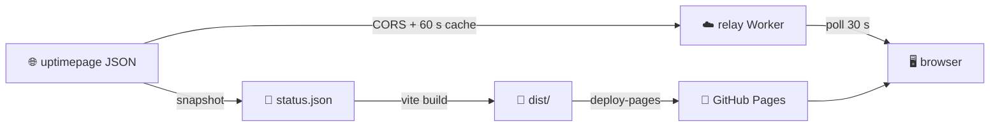

<picture>
  <source media="(prefers-color-scheme: dark)"
          srcset="https://raw.githubusercontent.com/ISC-HEI/isc-logos/main/white/ISC%20Logo%20inline%20white%20v3%20-%20large.webp">
  
</picture>

[](https://github.com/ISC-HEI/isc-uptime/actions/workflows/deploy.yml)
[](https://status.isc-vs.ch/)

# ISC status page

Static, ISC-themed front for the public status of the ISC services (HES-SO Valais-Wallis).
The monitoring itself runs on [uptimepage](https://isc3.uptimepage.dev/status); this repo only
owns the design: a [Vite](https://vite.dev/) + vanilla TypeScript page built with [Bun](https://bun.sh/)
that wears the shared ISC look (header, footer, tokens and theme of `@isc-hei/design`), is
rebuilt on GitHub Pages by a scheduled workflow and refreshes itself in the browser through a
small CORS relay. The page is in French.

**→ [status.isc-vs.ch](https://status.isc-vs.ch/)**

## Features

- **90-day history** — one strip per service on a shared month axis, coloured with the ISC petal palette
- **Uptime percentage** — per service and overall, computed from the incident timeline over the observed window
- **Incidents and maintenance** — active, recent and planned, with Swiss time and durations
- **Light and dark theme** — two-way toggle persisted under `isc.theme`, the same key as the ISC Hub
- **Snapshot first, live after** — the page paints the snapshot embedded at build time, then polls the relay every 30 s

## Quick Start

```bash
# Install dependencies
bun install

# Refresh src/data/status.json from the live API
bun run snapshot

# Dev server with hot reload
bun run dev

# What CI runs before deploying
bun run typecheck
bun test
bun run build
```

## Environment variables (`.env`)

`.env` is committed (it holds no secret) and read by Vite at build time. The uptimepage origin
is also hard-coded as `STATUS_BASE` in `.github/workflows/deploy.yml` for the snapshot script:
change both together.

```bash
# ── uptimepage (required) ─────────────────────────────────────────────
VITE_STATUS_BASE=https://isc3.uptimepage.dev   # public status page, no trailing slash

# ── Live refresh (optional) ───────────────────────────────────────────
VITE_STATUS_API=https://isc-status-relay.isc-hei.workers.dev   # CORS relay, empty = snapshot only
```

| Variable | Required | Default | Purpose |
|---|---|---|---|
| `VITE_STATUS_BASE` | yes | — | Origin of the uptimepage instance (permalinks, RSS, live fetch) |
| `STATUS_BASE` | no | `VITE_STATUS_BASE` | Same origin, read by `scripts/snapshot.ts`; set in the workflow |
| `VITE_STATUS_API` | no | `VITE_STATUS_BASE` | Origin of the CORS relay (`relay/`) for live refresh in the browser |

## Pipeline

The public API sends no CORS headers, so a browser cannot call it directly. Two paths feed the page.

**Snapshot, at build time.** The workflow runs on push and on a `*/5` cron, which GitHub
executes every 10 to 20 minutes in practice:

1. **`snapshot`** — fetches `/api/public/v1/status` into `src/data/status.json`
2. **Builds** — typecheck and unit tests, then Vite bundles the page with the snapshot embedded
3. **Deploys** — `actions/deploy-pages` publishes `dist/`

Changes to `main` go through a pull request: `.github/workflows/ci.yml` runs typecheck, tests and build
on it, without deploying, and the branch requires that check and one approval.

GitHub disables scheduled workflows after 60 days without a commit; a trivial commit every
couple of months keeps the cron alive.

**Live, in the browser.** The page polls the Cloudflare Worker in [`relay/`](./relay/) every
30 s. The Worker adds the CORS header and caches the JSON 60 s at the edge, so the displayed
state is at most about a minute old and uptimepage sees one request per minute whatever the
number of visitors. If the relay does not answer, the page keeps showing the snapshot.
To redeploy the Worker: `bunx wrangler deploy` from `relay/`.



The custom domain `status.isc-vs.ch` is set in the repository's Pages settings; a deployment
through `actions/deploy-pages` does not read a `CNAME` file.

## Design

The app is not Vue, so it cannot import the components of `@isc-hei/design`. It vendors the
package's tokens and the CSS of the ported components in `src/isc-design.css` (ISCHeader, Footer,
`.isc-fab`, `[data-tooltip]`) and renders the same markup from `src/render.ts`.
When the package changes upstream, re-vendor those blocks by hand.

## Project layout

```
scripts/snapshot.ts   fetch public JSON → src/data/status.json
src/types.ts          payload types
src/format.ts         French labels, Zurich time, state normalisation
src/uptime.ts         availability from the incident timeline
src/uptime.test.ts    unit tests (`bun test`), one `*.test.ts` next to the file it tests
src/theme.ts          two-way theme, localStorage isc.theme
src/render.ts         HTML rendering (header, hero, axis, strips, uptime, incidents, footer)
src/isc-design.css    vendored @isc-hei/design subset
src/style.css         page styles on top of the design tokens
src/main.ts           paint snapshot, theme toggle, strip popovers, live refresh through the relay
relay/worker.js       Cloudflare Worker: CORS + 60 s edge cache for the status JSON
```

---

## License

Copyright © 2026 P.-A. Mudry / ISC — HES-SO Valais. Released under the
[MIT License](https://opensource.org/license/mit).

---

*Made with ♥ by mui, 2026*
